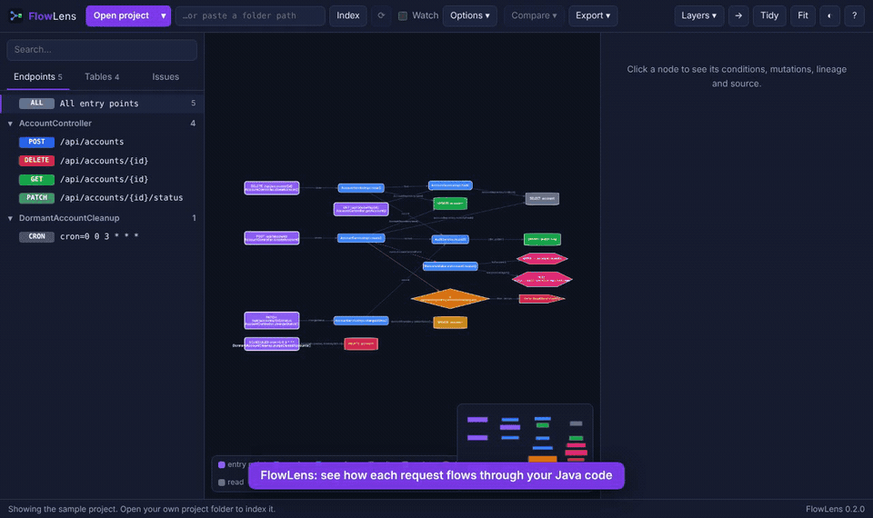
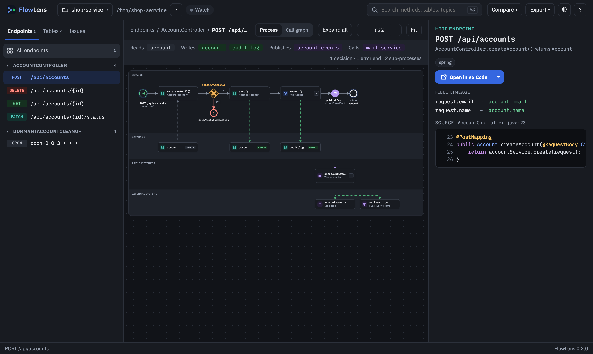
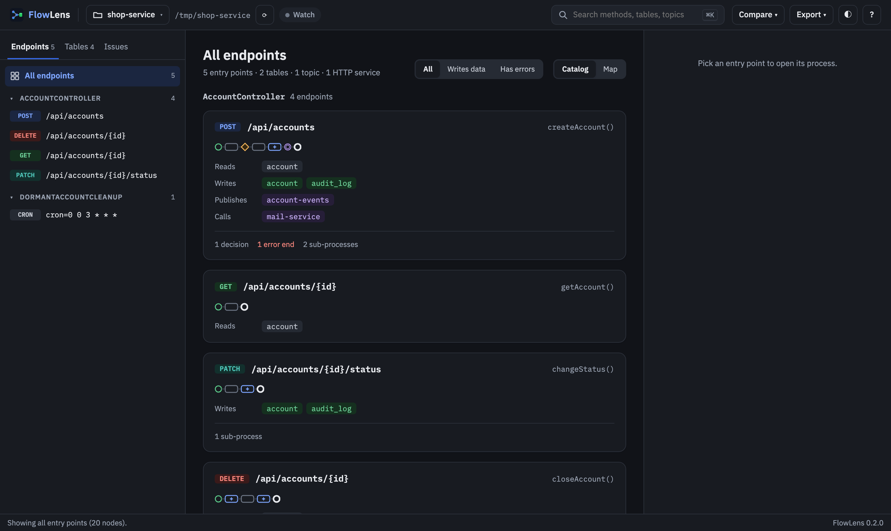
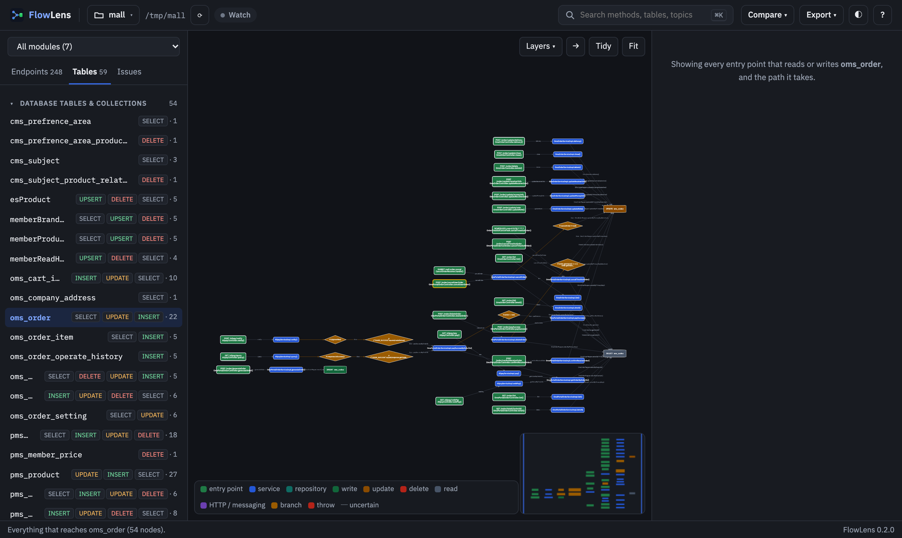
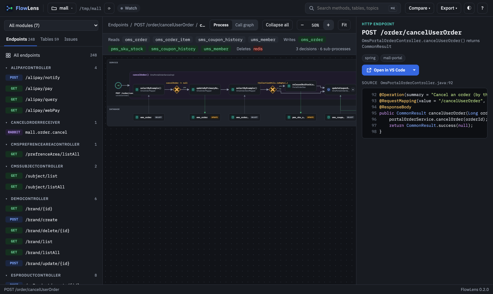
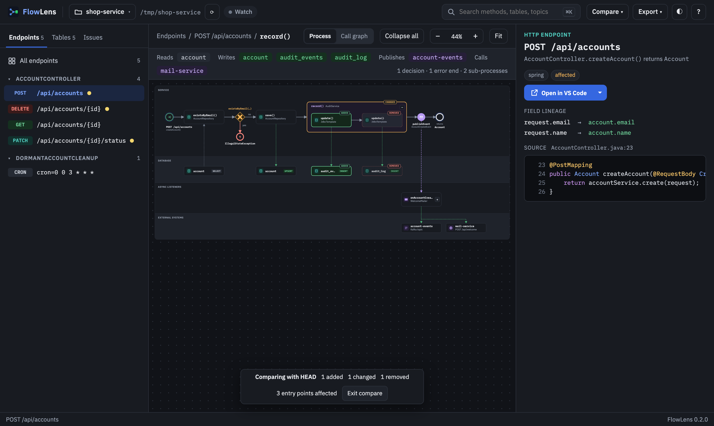
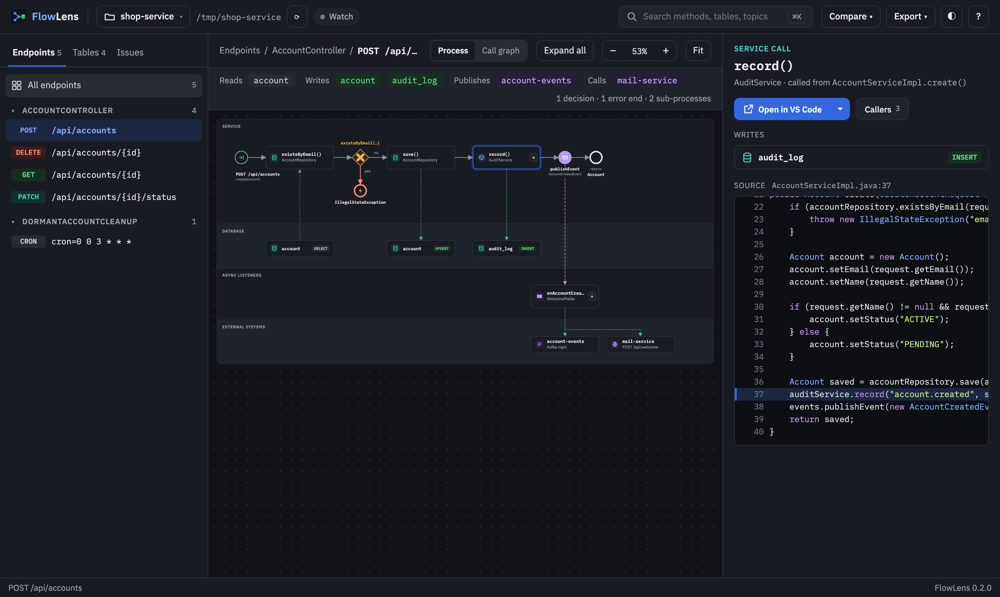
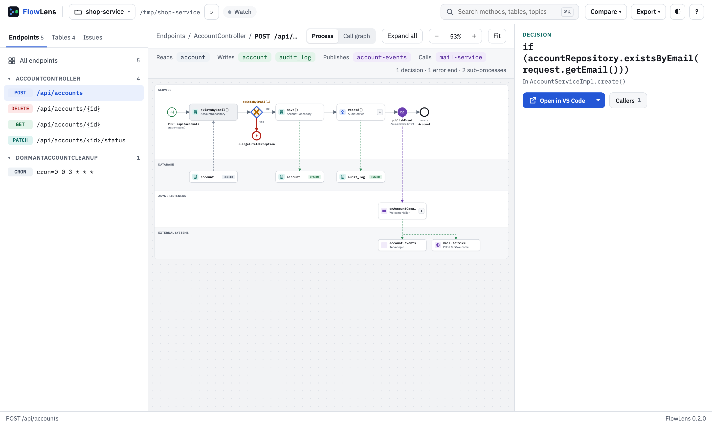
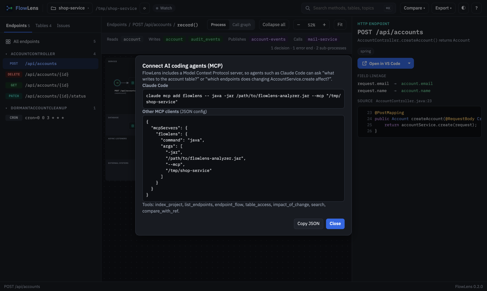
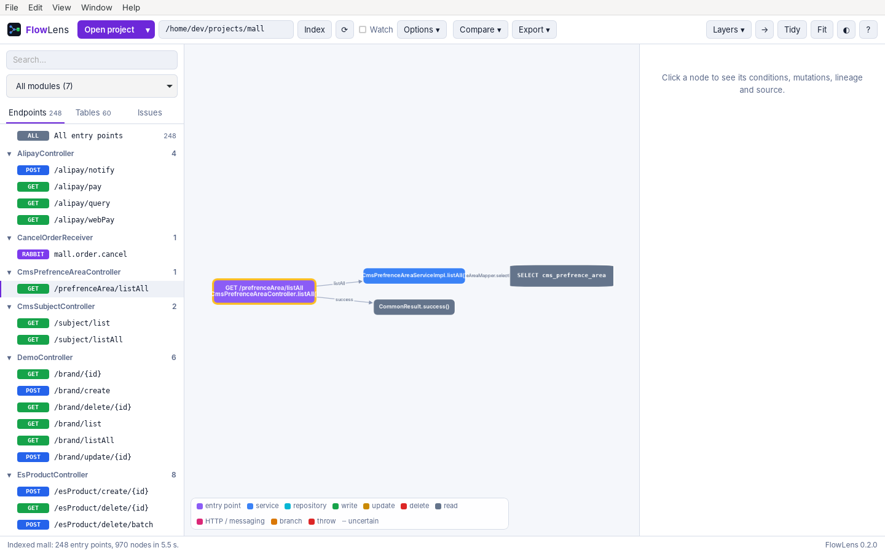

# FlowLens

**See how a request actually flows through your Java code — from the endpoint down to the database write.**

FlowLens statically analyzes a Java / Spring source tree and, for every entry point (HTTP endpoint,
message listener, scheduled job), builds a **data-flow graph**: the call chain through services and
repositories (including through interfaces), the branch conditions and throws along the way, and the
concrete sinks it reaches — `INSERT` / `UPDATE` / `DELETE` / `SELECT` on which table, which HTTP
service, which Kafka topic. It also traces which request field ends up in which column.

It reads **source only** — no build, no running app, no instrumentation. Nothing leaves your machine.

<p align="center">
  
  <br><sub>30-second tour on <a href="https://github.com/macrozheng/mall">macrozheng/mall</a> (7 modules, 524 files) ·
  <a href="docs/images/walkthrough.mp4">watch as MP4</a></sub>
</p>

## Install

Download the installer for your computer from the
[latest release](https://github.com/developerdsk/flowlens/releases/latest) (new versions are published
automatically as changes are merged into `main`):

| Computer | File |
|---|---|
| Windows 10/11 | `FlowLens_<version>_x64-setup.exe` (or `.msi`) |
| Mac with Apple Silicon (M1–M4) | `FlowLens_<version>_aarch64.dmg` |
| Mac with Intel | `FlowLens_<version>_x64.dmg` |
| Linux | `.AppImage` or `.deb` |

No Java needed — the app bundles its own runtime. Then **Open project…**, pick a folder, done.

> Builds are not code-signed yet, so the first launch needs one extra step:
> - **macOS**: open FlowLens once and close the warning, then go to **System Settings → Privacy &
>   Security** and click **Open Anyway** (or run `xattr -dr com.apple.quarantine /Applications/FlowLens.app`).
> - **Windows**: in the SmartScreen prompt choose **More info → Run anyway**.

## Screenshots

**One endpoint, as a process.** `POST /api/accounts`, step by step in call order: the `if` that guards
a `throw` is a decision with its error end, each step points at the table it reads or writes, and the
event listener's Kafka message and HTTP call sit in their own lanes. Sub-processes (`+`) open in place,
and the full call graph is one click away. On the right: request-field → column lineage and the source.



**Every endpoint at a glance.** *All endpoints* opens a catalog: one card per entry point with a sketch of
its steps and what it reads, writes, publishes and calls. Filter to the ones that write data or can fail;
*Map* shows them all as one graph.



<table>
<tr>
<td width="50%"><b>Who touches this table?</b><br>Pick a table to see every entry point that reads or writes it, and the path it takes (macrozheng/mall, <code>oms_order</code>).<br><br></td>
<td width="50%"><b>Big real projects</b><br>248 endpoints across 7 modules, MyBatis XML mappers, RabbitMQ listeners; here <code>cancelOrder()</code> is opened in place.<br><br></td>
</tr>
<tr>
<td><b>Compare with a git branch</b><br>Added (green), removed (red, dashed) and changed (orange) steps and tables, inside opened sub-processes too; affected endpoints are marked in the sidebar.<br><br></td>
<td><b>Every step explained</b><br>Branch conditions, mutations, callers/callees, highlighted source, one click to open it in VS Code, IntelliJ or Cursor.<br><br></td>
</tr>
<tr>
<td><b>Light or dark</b>, following your OS.<br><br></td>
<td><b>For AI coding agents (MCP)</b><br>Let Claude Code and other agents ask FlowLens about flows, tables and impact.<br><br></td>
</tr>
<tr>
<td colspan="2"><b>An installable desktop app</b> — native menus, dialogs and recent projects; no Java needed.<br><br></td>
</tr>
</table>

## What you get

- **Endpoint explorer** — every entry point grouped by class, like a Postman collection; search.
- **Process view** — each entry point as ordered steps in lanes (service, database, async listeners,
  external systems), with decisions, error ends and sub-processes that open in place.
- **Catalog** — all entry points as cards: a sketch of the steps, tables, topics, services, schedules.
- **Call graph** — controller → services → repositories → tables / HTTP / topics, with `if`/`switch`
  branches and throws as nodes; dashed edges where FlowLens is unsure.
- **Tables view** — pick a table and see every endpoint that reads or writes it.
- **Detail panel** — field lineage (`request.email → account.email_address`), SQL, conditions,
  mutations, callers/callees, highlighted source, **Open in VS Code / IntelliJ / Cursor**.
- **Compare** — diff the flow against a git branch or a saved snapshot; affected endpoints light up.
- **Watch mode**, export to **PNG / SVG / Mermaid**, shareable **.flowlens** snapshots.
- **MCP server** — let AI coding agents ask "what writes to the `account` table?"
  (Help → *Connect AI Agents*).

### Supported frameworks

| | |
|---|---|
| Entry points | Spring MVC & WebFlux (annotated and router functions, mappings inherited from OpenAPI-generated interfaces), JAX-RS / Quarkus / Jakarta EE, Micronaut, Kafka / RabbitMQ / JMS / SQS / Spring Cloud Stream listeners, `@Scheduled`, Quartz |
| Data access | Spring Data (JPA, JDBC, R2DBC, MongoDB, …) incl. `@Query` and derived queries, JPA `EntityManager` / Hibernate `Session`, `JdbcTemplate`, `JdbcClient`, MyBatis (XML + annotations, MyBatis-Plus), jOOQ, `MongoTemplate`, Redis |
| Outbound | OpenFeign, Spring `@HttpExchange`, MicroProfile REST client, `RestTemplate`, `WebClient`, `RestClient`, Kafka / RabbitMQ / JMS / Stream / SQS / SNS producers, Spring application events |
| Java | up to Java 21 syntax; multi-module Maven/Gradle; non-UTF-8 sources |

## How it works

```
  Java sources ──► engine (analyzer/, Java)            ──► graph.json ──► viewer (viewer/, JS)
                   JavaParser + FlowLens type resolver                     process view (elkjs),
                   entry points → call walk → sinks                        call graph (Cytoscape),
                   lineage, diff, MCP, local API                           desktop app or browser
```

The desktop app (`desktop/`, Tauri 2) bundles the engine with a minimal Java runtime and talks to it
over a token-protected loopback connection.

## Other ways to run it

Needs Java 17+.

```bash
./run.sh            # macOS / Linux: builds once, then opens http://localhost:7070
run.bat             # Windows
```

```bash
cd analyzer && ./mvnw -DskipTests package
java -jar target/flowlens-analyzer.jar <project> graph.json          # one-shot JSON
java -jar target/flowlens-analyzer.jar <project> --ref main          # analyze a git ref
java -jar target/flowlens-analyzer.jar --diff base.json head.json     # what changed
java -jar target/flowlens-analyzer.jar --mcp <project>                # MCP server on stdio
claude mcp add flowlens -- java -jar /path/flowlens-analyzer.jar --mcp /path/to/project
```

### Privacy & safety

The engine binds to **127.0.0.1 only**, rejects requests whose `Host`/`Origin` isn't itself (no DNS
rebinding or cross-site use), accepts only JSON posts, and in the desktop app requires a per-launch
secret. It never executes or loads the analyzed code. No telemetry.

## Development

See [CONTRIBUTING.md](CONTRIBUTING.md), [desktop/README.md](desktop/README.md) (building and releasing
installers), [docs/QA-CHECKLIST.md](docs/QA-CHECKLIST.md) and [docs/PERFORMANCE.md](docs/PERFORMANCE.md).

## Roadmap

See [ROADMAP.md](ROADMAP.md) and [TODO.md](TODO.md).

## License

Apache-2.0. Contributions welcome.
